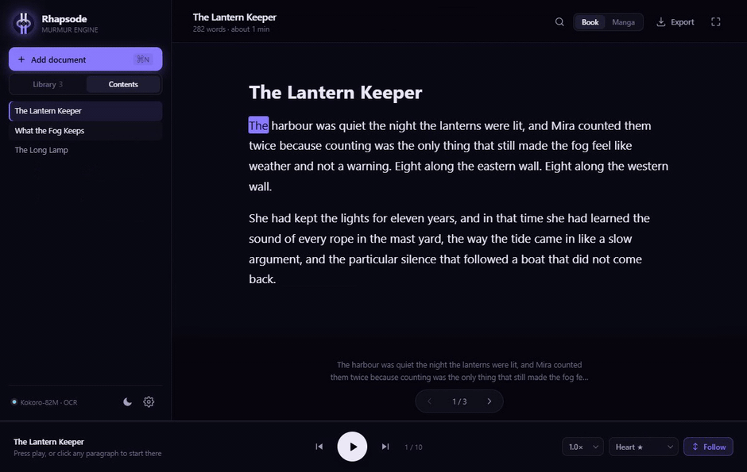
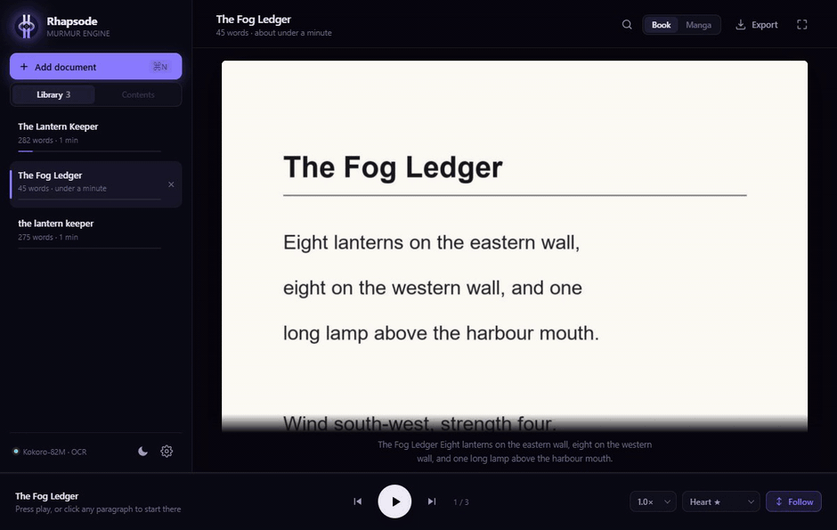
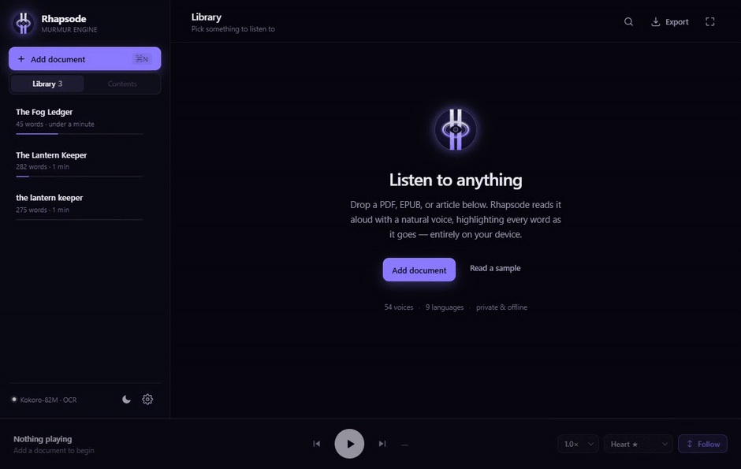
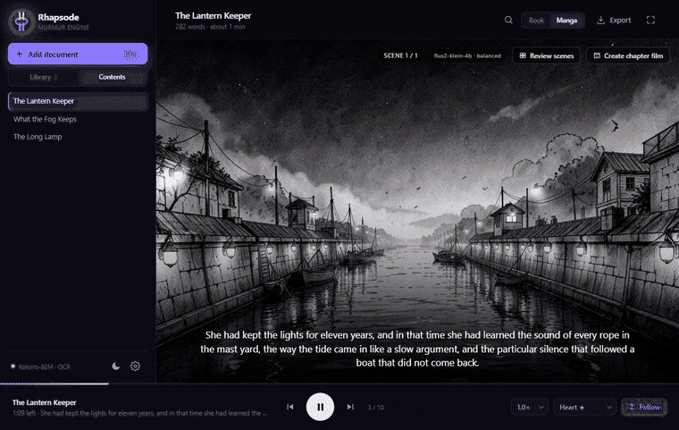
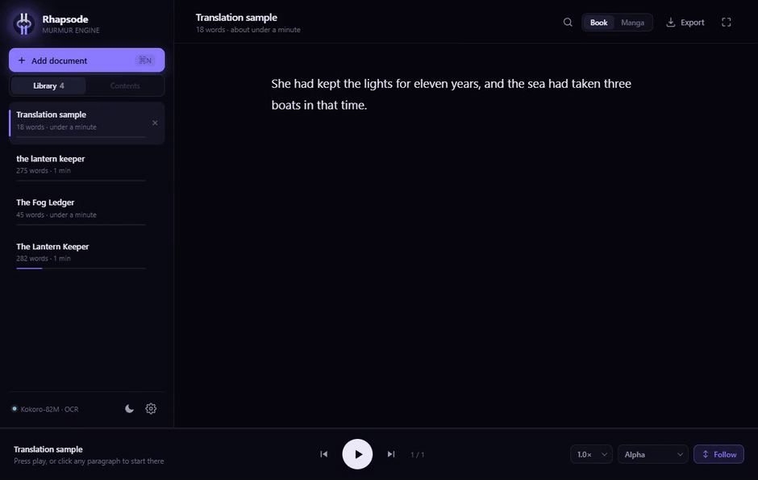
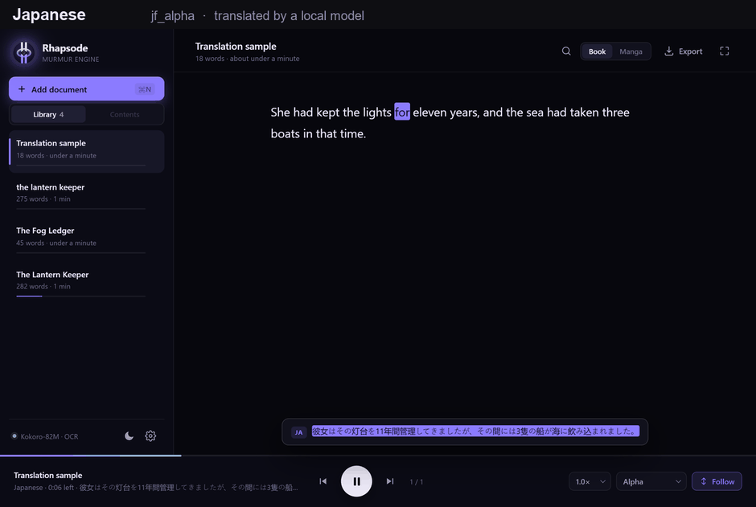

Turn anything you can read into an audiobook, while you read it. Drop in a book, a
PDF, a scanned page, a screenshot or a web page and Rhapsode speaks it in a local
voice, follows the words with the voice, and — if you want — paints the scenes it
reads into manga-style stills. No account, no cloud, no per-word billing, no upload.

    [](https://github.com/endynamoo/rhapsode/actions/workflows/windows.yml) [](https://github.com/endynamoo/rhapsode/actions/workflows/linux.yml)

## In motion

Five things that are easier to watch than to read about. Every clip is a recording of this
build playing text written for the demo - no mock-ups, nothing staged by hand. The files it
plays, and the method that records them, are in [docs/demo](docs/demo/README.md).

**The word being spoken is the word marked.** Kokoro returns phoneme timings, so the mark
tracks the voice at any speed instead of guessing from the clock, and every sentence paints
its first word before the sound starts.



**A scanned page, marked on the page itself.** This PDF has no text layer at all: the page
is OCR'd, the words are located on the image, and the box follows the voice across it - not
a caption underneath pretending to be one.



**Search every book at once, by words or by meaning.** Nine passages in 15 ms, grouped by
book, each snippet showing what matched, and Enter opens that sentence.



**A chapter drawn while it is read.** Each beat of the text becomes one still, painted
locally, played against the narration - and the same stills assemble into a chapter film.



**English text, Japanese voice, both on this machine.** With a Japanese voice chosen, the
sentence is translated first and then read in Japanese - the translation bar shows what is
being said, and the audio follows it. The translation comes from a local OpenAI-compatible
server, the voice from Kokoro; nothing leaves the machine.



The GIF is silent - a README cannot play a video file, so this is the picture of the feature
working, not the sound of it. The voice is Kokoro's Japanese, chosen from the voice menu.

**One sentence, three languages.** Same sentence, same reader, three voices - the word mark
stays on the English word being spoken while the bar carries the translation, and the reader
takes whichever voice you pick:



The sound is real, and it is in this repository as plain files - download and play them in
whatever you already use:

- **[one-sentence-four-voices.mp3](docs/demo/audio/one-sentence-four-voices.mp3)** (27 s) - that
  sentence in English, then Japanese, then Spanish, then French
- **[reading-sample.mp3](docs/demo/audio/reading-sample.mp3)** (26 s) - the demo book's opening,
  read by one English voice

GitHub renders no audio or video from a repository, so a README cannot play them; docs/demo
explains the two ways to get a playing player into one.

## What it does

- **Reads anything** — pasted text, PDF, EPUB, DOCX, RTF, TXT, Markdown, an image,
  or a URL it extracts the article from. A damaged or mislabelled file is refused
  with a sentence saying what is wrong, not a stack trace.
- **Book view with a real word highlight** — EPUBs render their own chapters, PDFs
  page by page, scanned pages through OCR, and the highlight is driven by Kokoro's
  phoneme timings rather than a guess, so the words and the voice stay together on a
  long chapter, at 0.75× or at 3×. Each sentence's first word is painted before the
  voice starts, so the mark is never trailing the sound.
- **OCR built in** — scanned pages and screenshots, on-device: Apple Vision on
  macOS, Windows.Media.Ocr on Windows, Tesseract on Linux. On a scanned PDF the
  spoken word is marked on the page itself, not only in the text under it.
- **On-device translation** — read a foreign book in your own language, or in the
  foreign voice with the translation shown under the player. Apple's Translation
  framework on macOS 26 and later; a local OpenAI-compatible server everywhere
  else, configured or discovered on the usual ports.
- **Manga stills** — the narration is planned into beats and each beat gets one
  locally generated still (FLUX.2 [klein]). A polish pass re-draws each still once
  from itself so the ink settles, with an optional face repair that is off by
  default because it can redraw a character into someone else. Chapter view plays
  the stills against the voice; a chapter can be assembled into a 1080p MP4.
- **Quick Read** — one hotkey reads whatever is selected in any app; with no
  selection it OCRs the clipboard image.
- **Library search** — find a passage across every book you have imported, by words
  or by meaning, with the snippet marked and a jump straight to that sentence
  (`Ctrl+F`). Keyword search needs nothing extra; the 23 MB meaning model is
  optional, off by default, and downloads only when you ask.
- **It is quick because it is warm** — opening a book queues the audio for the first
  sentences in the background, so the first press of Play is a cached clip rather
  than a wait. 54 voices · 9 languages · 0.75–3× · 20 themes · your place remembered
  per document.

Everything stays on the machine: the voice model, the audio cache, the stills and
the library are local files. Nothing is uploaded, and remote access is off unless
you deliberately turn it on and hand out the tokenised link.

## Who this is for

**Somebody who wants their reading turned into audio, now.** You have a PDF for a
deadline, a 600-page book you keep not starting, an article you saved, a screenshot
of a page, an EPUB in a language you are still learning. Rhapsode reads it aloud in
seconds, remembers where you were, and keeps working with the network unplugged.
Nothing is exported to a service and nothing is charged by the word.

**Somebody who likes the look of generated manga.** Give the narration to the
Cinema pane and each beat of the text gets one still, drawn locally: ink, panel
framing, the drift and dissolve of a slow page turn, and a chapter you can render
into a 1080p MP4 cut to the voice. The pictures are still images on purpose — no
video model, no animation, no flicker to sit through.

**Somebody who wants to turn this into a different program.** Rhapsode is plain
Python and plain web assets: one FastAPI process on loopback, the UI served from the
same origin, no Node runtime, no bundler, no Electron, no framework to learn first.
The engine, the library, the OCR, the aligner, the painter and the API are separate
modules with the seams written down in [docs/ARCHITECTURE.md](docs/ARCHITECTURE.md).
Lift the narration out and build a podcast tool. Lift the library and build a
research reader. Lift the painter and build something that is not a book at all. The
licence permits it, and the map is already drawn.

## The stack, and why this mix

No single piece here is exotic. What makes the combination work is that the voice is not a
black box: Kokoro's ONNX model returns *phoneme* durations, so narration arrives as a
timeline the rest of the program can read. Everything below is downstream of that fact.

- **TTS: Kokoro-82M through ONNX Runtime** — 54 voices, 9 languages, CPU only, and no
  PyTorch anywhere in the reading path (the ~2.5 GB torch stack stays out unless you
  install the stills). `create_timed()` hands back per-word offsets instead of a wall of
  audio, and those offsets are the hinge the app turns on: the same numbers drive the
  word highlight, decide where a sentence ends and the next begins (which is what the
  player warms ahead of), become the timing the stills are played against, and set the
  cut points of a chapter MP4. Nothing
  downstream guesses at timing, so nothing downstream drifts.
- **G2P: misaki for Japanese and Chinese, eSpeak NG behind Kokoro for the other seven
  languages** — the phoneme inventory decides whether a word is sayable at all, so those
  are two code paths and not a preference.
- **Server: FastAPI + uvicorn on loopback; the UI is plain HTML, CSS and JavaScript** —
  same origin as the API, no bundler, no Node runtime, no Electron, so the interface you
  inspect in DevTools is the one that ships and the same files run on all three
  platforms. Server-sent events carry cross-tab work like indexing and painter progress.
- **Documents: PDFium (`pypdfium2`), `trafilatura`, `python-docx`, EPUB as a zip** — a
  permissive stack that *renders* pages rather than only extracting their text, which is
  the only reason the page-level highlight can exist.
- **OCR: Apple Vision, `Windows.Media.Ocr`, Tesseract** — one per platform, all on-device,
  nothing to download. The backend in use is named in `/api/health`, so a wrong one is
  visible rather than silent.
- **Search: SQLite FTS5 plus an optional 23 MB MiniLM embedding model on the same ONNX
  runtime** — keyword search works with nothing installed; the meaning lane is a file you
  may or may not have. Both rankings are fused with reciprocal rank fusion
  (`Σ 1/(60 + rank)`) and a recency decay instead of being switched between, so a phrase
  match does not lose to a vaguely similar paragraph.
- **Stills: FLUX.2 [klein] 4B through diffusers on CUDA/ROCm or mflux/MLX on Apple
  Silicon, q4 GGUF on tighter cards, YuNet and RTMDet ONNX detectors for the polish pass** —
  in a separate process holding a VRAM budget, so it refuses early rather than being
  killed halfway through a chapter. Measured at 10.9 GB peak for an 832×480 frame in four
  steps; the numbers are in [docs/STILLS.md](docs/STILLS.md).
- **Packaging: PyInstaller, Inno Setup 7, ad-hoc codesign** — per-user installs with no
  admin rights and a bundle that launches without a developer account, which is what makes
  "download it and read something" a single step.

What that buys, in one sentence: it plays as soon as you ask because the clip is already
warm, the mark sits on the word because the timing is the model's own and not an estimate,
and it works with the network unplugged because every piece above is a file on your disk.

## Install

**[Releases →](https://github.com/endynamoo/rhapsode/releases)** carries prebuilt
artifacts; the source install works everywhere.

**Windows 10/11** (preview) — the per-user installer needs no admin rights and can
build the stills engine during the wizard. Download `Rhapsode-<version>-Setup.exe`,
or build it yourself with Inno Setup 7:

```powershell
.\scripts\build_installer.ps1   # writes dist\Rhapsode-<version>-Setup.exe
```

From source (needs `uv` and `ffmpeg`, Python 3.12):

```powershell
.\scripts\setup.ps1        # reader + stills engine + profile, auto-detected from the card
.\run.ps1                  # add -Desktop for a native WebView2 window
```

`setup.ps1` reads the card, picks an engine profile, downloads the q4 transformer
and the detectors, and writes `%LOCALAPPDATA%\Rhapsode\engine.json`. Override it
whenever you like: `.\scripts\setup.ps1 -Profile lite` (or `balanced`, `max`).

**macOS** (Apple Silicon or Intel, needs `uv` and `ffmpeg`) — download the DMG for
your architecture from Releases, or:

```bash
./run.sh              # venv, deps, ~340 MB model, then opens http://127.0.0.1:8765
./build_app.sh        # optional: a real .app bundle
./scripts/make_dmg.sh # optional: drag-install DMG in dist/
```

**Linux** (preview, source only — there is no packaged build yet):

```bash
./run.sh              # browser mode; see INSTALL.md Section C for the desktop window
```

Step-by-step instructions, per-GPU notes (CUDA, ROCm, DirectML still planned) and
the verification checklist live in **[INSTALL.md](INSTALL.md)**.

## Platform status

| Platform | Read / TTS / highlight | Chapter stills → MP4 | Native bundle |
|---|---|---|---|
| macOS 13+ (Apple Silicon) | supported | supported (MPS + MLX) | `.app` + DMG |
| macOS Intel | supported | placeholder (CPU painting planned for 0.4) | `.app` + DMG |
| Windows 10/11 x64 | preview, installer or source | NVIDIA CUDA or AMD ROCm; placeholder without one | Inno Setup installer (preview) |
| Linux x64 | preview, source install | NVIDIA CUDA or AMD ROCm; placeholder without one | not yet |

AMD ROCm is wired into the stills engine through diffusers — measured on an RX 9070
XT — while DirectML and Intel OpenVINO are still planned. A machine with no usable
GPU still reads, narrates, searches and exports; its stills are placeholders, because
CPU painting is not shipped (it is issue
[#81](https://github.com/endynamoo/rhapsode/issues/81), planned for 0.4). Details in
[docs/PLATFORMS.md](docs/PLATFORMS.md).

## Where this is going

Rhapsode is one of three, and the other two are being built on what it taught:

- **Rhapsode** — this one. Reading, narration, and the manga stills.
- **Opsis** — next. It turns a book into a movie: scenes directed from the text,
  generated and polished, assembled into clips and cut together into a film. An alpha is
  already running; the open beta is targeted for before the new year.
- **Poiesis** — the portfolio site that gathers the family together.

## How this was built

Rhapsode is AI-written software with a human director. Most of the code came from
**DeepSeek V4.1 Flash 1017** working in long supervised sessions, and the
architecture, the standards and the decision about what ships stayed with one
person — who keeps that director's role across every program here.

The repo is built so the claims are checkable rather than taken on faith: the suite
in `tests/` (its browser-driven half in `tests/ui/`), the workflows in
`.github/workflows/`, the local runner `scripts/ci-local.ps1` that can replay those
workflows on your own machines when CI minutes are gone, the end-to-end checklist in
[INSTALL.md](INSTALL.md) §6, and an [architecture
document](docs/ARCHITECTURE.md) that spells out the API surface, the security model
and the decisions behind them.

None of that makes it authority. This is AI-written code with a human editor — read
it before you depend on it, and look hardest at the parts that handle other people's
files and the network: document extraction, OCR input, and the remote-access token.

## Bugs are the priority, and pull requests move slowly

The app is fully functional. It is not looking for new surface area; it is looking
for the same experience on every system, and for the bug you found that I did not.

- **Bug reports are the most useful thing you can send**, and a reproduction beats a
  description: which platform, which file type, what you expected, what happened.
- **Pull requests will be slow.** I review them myself, I do not merge anything I
  cannot verify on the machine in front of me, and I would rather leave a good patch
  sitting for a week than merge one I cannot stand behind. Please be patient, and do
  not read silence as no.
- **Expectations are in [CONTRIBUTING.md](CONTRIBUTING.md)** — branch names, the
  changelog entry that rides with a change, and the suites to run before you push.

## Documentation

| Doc | Contents |
|---|---|
| [docs/USAGE.md](docs/USAGE.md) | Keyboard map, Quick Read, translation, OCR knobs, remote access, where your data lives, troubleshooting |
| [docs/SEARCH.md](docs/SEARCH.md) | Cross-library search: index, ranking, recency, the optional model, API |
| [docs/STILLS.md](docs/STILLS.md) | Manga stills, chapter stills, the Murmur engine sidecar |
| [docs/TROUBLESHOOTING.md](docs/TROUBLESHOOTING.md) | VRAM and RAM guards, where the logs are, failure modes already fixed |
| [docs/ARCHITECTURE.md](docs/ARCHITECTURE.md) | Module map, pipelines, API surface, security model, UML |
| [docs/PLATFORMS.md](docs/PLATFORMS.md) | Windows and Linux port, GPU backends, packaging |
| [CONTRIBUTING.md](CONTRIBUTING.md) | Branches, commits, pull requests and releases |
| [INSTALL.md](INSTALL.md) | Install, build and verify, platform by platform |
| [AGENTS.md](AGENTS.md) | The rules an automated agent works to in this repository |
| [THIRD_PARTY.md](THIRD_PARTY.md) | Dependency, model and license inventory |

## License

Rhapsode's own code is MIT — see [LICENSE](LICENSE). Kokoro-82M weights are
Apache-2.0, so commercial use is fine. A GPL-3.0 component (eSpeak NG, reached
through `phonemizer`) is inside every built bundle because the narration engine
phonemises with it, so redistributing a **built bundle** carries GPL obligations even
though the source stays MIT; the inventory is in [THIRD_PARTY.md](THIRD_PARTY.md).

The licence texts for the copyleft components, the exact versions this build uses,
and the written offer for their source are in [`licenses/`](licenses/), and every
release ships that folder inside the installer and inside the `.app`.

## Changelog

<!-- CHANGELOG:BEGIN -->

Newest first. The full history is in [CHANGELOG.md](CHANGELOG.md); this block is generated from it by `scripts/changelog_render.py`, so edit the changelog, not this copy.

### Unreleased

**Added**

- **ffmpeg can be installed from Settings.** Without it MP3 export fell back to WAV and chapter films could not be cut, and the error told every platform to use Homebrew. Settings → ffmpeg fetches the pinned gyan.dev release build (9.1, 113 MB, sha256 checked) into the data directory; `config.find_tool` prefers that copy over PATH. That build is **GPL-3.0**, so `licenses/NOTICE.txt`, `licenses/SOURCES.md` (source commit and written offer) and `THIRD_PARTY.md` name it, and the archive's own LICENSE is kept beside the binary. Nothing GPL is added to the installer: the reader asks for the download.
- **The stills engine is offered on first start, not discovered inside Cinema.** A machine with a supported GPU used to meet Manga as "no stills engine" with advice to run a PowerShell script. The first-run sequence now ends with a third card - after the voice and translation - offering *Set up the stills engine, about 16 GB, one time*: one tick, the same script the installer's optional task runs, its output on screen, and Settings → Stills engine to start it again. A machine with no usable GPU is not offered it, because a placeholder is the right answer there.

### 0.3.6-beta - 2026-11-24

**Fixed**

- The release check that installs the app into a throwaway profile no longer damages the machine's own Rhapsode entry in Apps. An entry left behind by a previous run of that check was saved as if it were the machine's and put back later, pointing at a temp directory that had been deleted - which is how a real 0.2.0-alpha entry was lost on 2026-11-23. Such an entry is now recognised at the start of the run and removed at the end, while a genuine entry is still saved and restored exactly as it was.

*...and 151 more entries in [CHANGELOG.md](CHANGELOG.md).*

<!-- CHANGELOG:END -->

---

I hope this makes a book more accessible, and more fun to get through, than it was
before you opened it.
