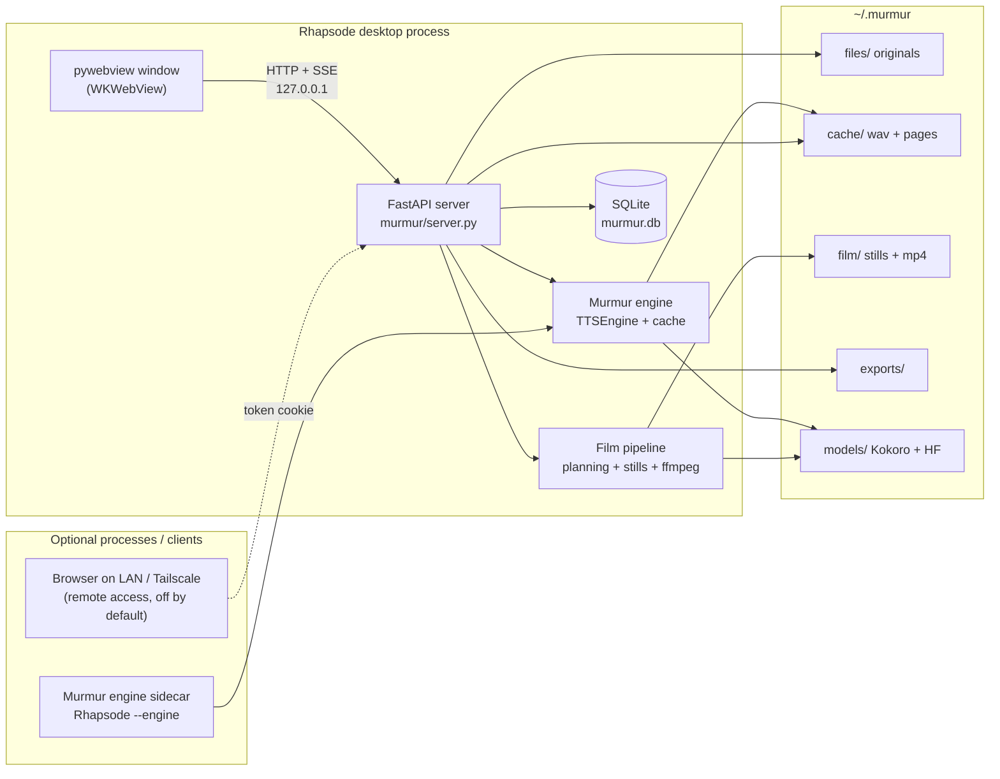
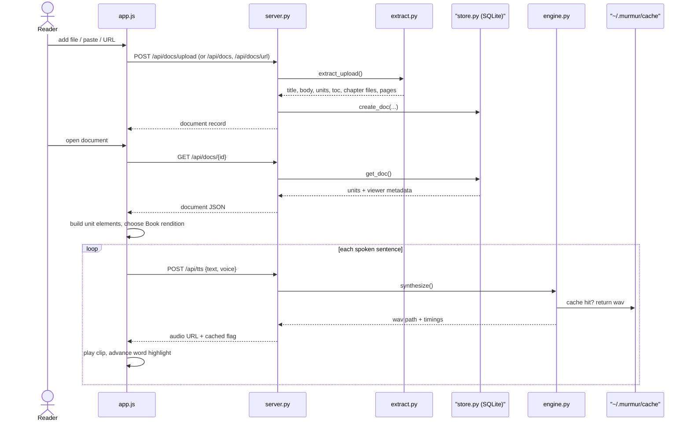
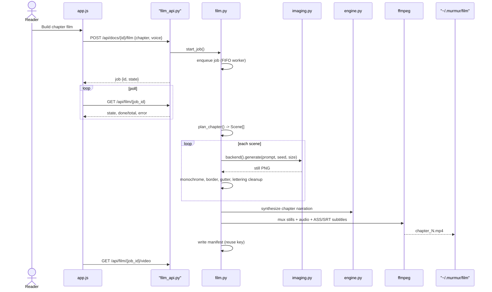
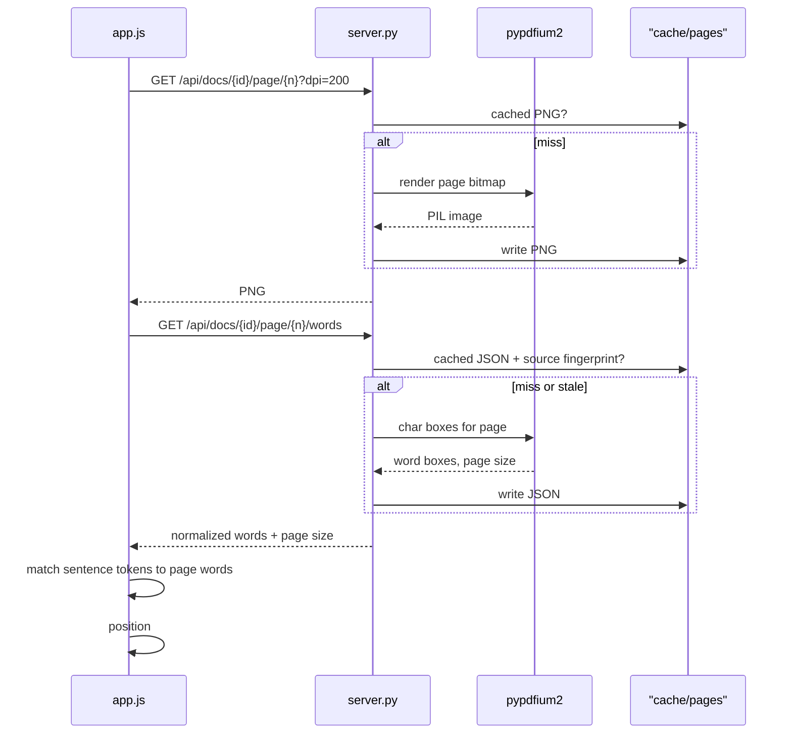
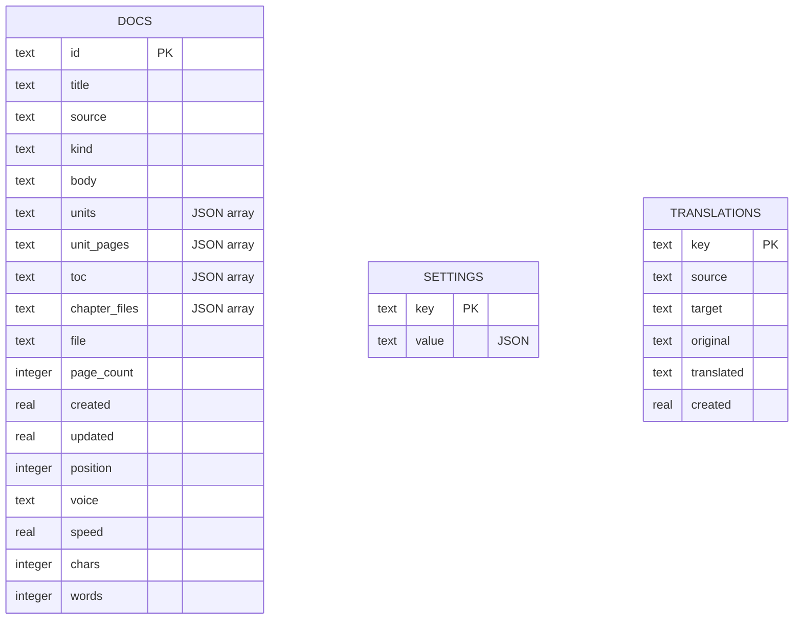
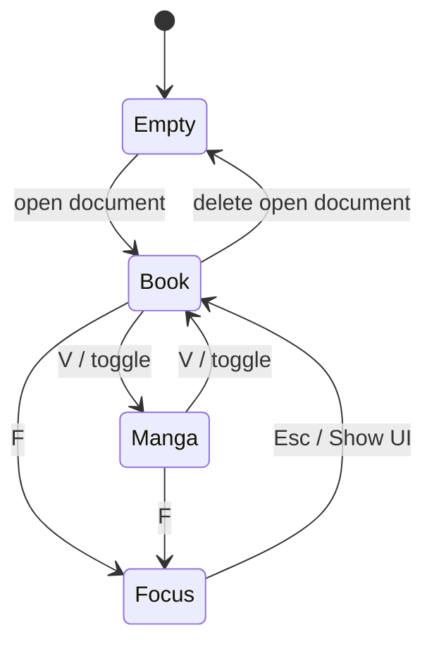
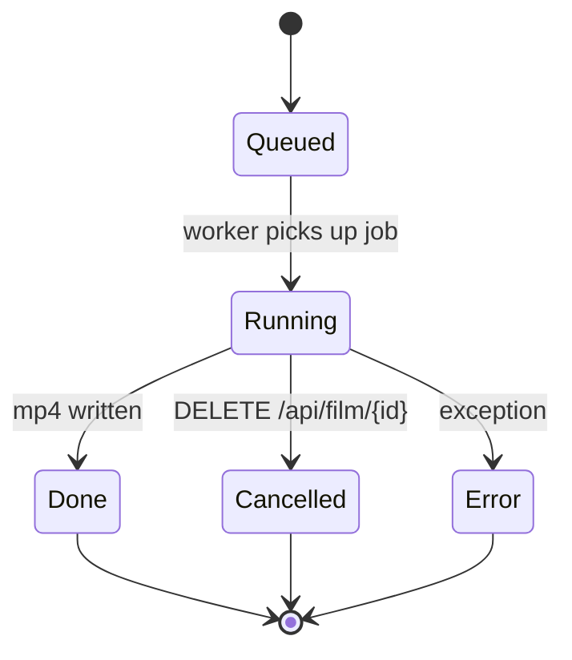
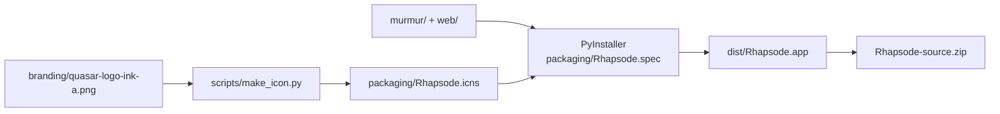

# Rhapsode architecture

Rhapsode is a local read-aloud and manga-film desktop app. The UI is a small
web app served by an in-process FastAPI server; all speech, OCR, translation
and image generation run on the machine. There is no cloud dependency and no
telemetry.

- **Rhapsode** — the desktop app and reader UI.
- **Murmur** — the speech / film engine (also available as a sidecar service).

This document describes the current macOS implementation. The cross-platform
and GPU plan is in [PLATFORMS.md](PLATFORMS.md).

---

## 1. System context



The desktop window and the server share one process. `Rhapsode --engine` starts
only the engine router (health, version, film endpoints) for other frontends.

---

## 2. Module map (UML class diagram)


New in the portability pass: `murmur/backends/detect.py` probes the OS, GPU and
ONNX providers; `murmur/backends/tts.py` selects the Kokoro execution provider;
`murmur/ocr.py` is a facade over Apple Vision and Tesseract; and
`murmur/fonts.py` enumerates installed fonts.

`murmur/film_api.py` is the shared FastAPI router mounted by both the desktop
server and the engine sidecar. `murmur/runtime.py` resolves whether the server
binds loopback or `0.0.0.0` from `--host`, `MURMUR_HOST`, or the saved
`remoteAccess` setting.

---

## 3. Reading pipeline



Notes:

- Speed is applied in the browser, so changing playback speed does not
  re-synthesize audio.
- TTS cache keys include model version, voice, and prepared text. Clips are keyed by
  `sha1(model version + voice + text)`, written atomically to the cache directory,
  and evicted LRU-style at 2 GB (`MURMUR_CACHE_MB`).
- **Sentence units.** Text is split on real sentence boundaries with abbreviation,
  initial and decimal protection. Tiny fragments (headings, `"Yes."`) are merged into
  a neighbour because Kokoro sounds worse on very short inputs, and overly long
  sentences are split at clause punctuation.
- **Timing.** `kokoro-onnx` exposes per-phoneme start/end times. Phonemes are folded
  into word groups (the phonemizer emits a space phoneme between words) and mapped
  onto the original tokens — exact for normal prose, proportionally interpolated for
  numbers and dates that expand into several spoken words.
- `state.wordIdx` drives highlight in all Book renditions: reader spans, EPUB
  iframe spans, and the PDF page overlay.

---

## 4. Chapter film pipeline

The internal names still say *film* — `film.py`, `film_api.py`, `/api/film/*` — but
what the pipeline produces is stills: one generated image per beat, played against
the narration. The MP4 is those stills assembled with dissolves and subtitles. No
motion is synthesized, and no video model is loaded.



Scene review uses `GET /api/film/plan`, `POST /api/film/scene/regenerate`
(`whole` or dragged `region`), and `POST /api/film/prefetch`. Region redraws
crop the selection, redraw with the selected backend, tone-match, and feather
the patch back into the still.

---

## 5. PDF page and word overlay



PDFium is not thread-safe, so both endpoints share `_PDF_LOCK`. Word caches are
keyed by document id and page, and validated against the source file size and
mtime so replacing a PDF cannot serve stale boxes.

---

## 6. Data model



Filesystem layout (macOS shown; see below for Windows/Linux):

```
~/.murmur/
  murmur.db                 library, settings, translations
  access_token              remote-access secret (0600)
  fonts.json                cached font list
  files/<doc_id>.<ext>      original PDF/EPUB/image
  cache/<hash>.wav          TTS clips
  cache/pages/<doc>_<n>*.png|json
  film/<doc_id>/            stills, prompts, cast, chapter mp4
  exports/<job>.mp3|wav     audio exports
  search.db                 derived search index (safe to delete)
  models/                   Kokoro + HF weights (external)
  models/minilm-l6-v2/      optional search embeddings
  image-venv/               optional FLUX runtime
```

Data root by platform (override with `MURMUR_HOME`):

- macOS: `~/.murmur`
- Windows: `%LOCALAPPDATA%\Rhapsode`
- Linux: `$XDG_DATA_HOME/rhapsode` or `~/.local/share/rhapsode`

`search.db` is not part of the library. It holds `books` (per-document
signature and coverage), `chunks` plus its FTS5 index, `vectors` (float32
embeddings), `progress` (reading recency) and `meta`; it is rebuilt from `docs`
whenever it is missing or stale. See [SEARCH.md](SEARCH.md).

---

## 7. Concurrency

| Work | Mechanism | Notes |
| --- | --- | --- |
| HTTP handlers | Uvicorn worker + threadpool | sync handlers run off the event loop |
| TTS synthesis | `TTSEngine._compute` semaphore (2) | model load guarded by a lock |
| PDF render / words | `server._PDF_LOCK` | PDFium is not thread-safe |
| Audio export | `server._EXPORT_LOCK` | one export at a time |
| Search index | one daemon worker in `murmur/search.py` | writes in batches of 200; readers use WAL |
| Search model | background download thread in `murmur/semantic.py` | streams to `*.part`, styled by `status()` |
| Chapter film | FIFO worker in `film.py` | one film job at a time |
| Live events | SSE `/api/events` | quick-read notifications |
| Cache pruning | startup thread | audio LRU + 7-day export cleanup |

---

## 8. API surface

| Method | Path | Purpose |
| --- | --- | --- |
| GET | `/api/health` | server, model, OCR, translation, platform/GPU status |
| GET | `/api/network` | connection URLs; token only on loopback |
| GET/PUT | `/api/settings` | persisted preferences |
| GET | `/api/voices` | Kokoro voices by language |
| GET | `/api/fonts` | installed font families |
| POST | `/api/tts` | synthesize one sentence |
| GET | `/api/audio/{name}` | cached wav (range requests) |
| GET/POST | `/api/docs` | list / create text documents |
| POST | `/api/docs/upload` | upload PDF, EPUB, image, Office, HTML |
| POST | `/api/docs/url` | import a web page |
| PATCH/DELETE | `/api/docs/{id}` | update position/voice/speed, remove |
| GET | `/api/docs/{id}/page/{n}` | rendered PDF page |
| GET | `/api/docs/{id}/page/{n}/words` | normalized word boxes |
| GET | `/api/docs/{id}/image` | single-image document |
| GET | `/api/docs/{id}/epub/{asset}` | EPUB internal asset |
| GET | `/api/docs/{id}/chapter/{n}` | themed EPUB chapter HTML |
| POST | `/api/docs/{id}/export` | audio export job |
| GET/DELETE | `/api/export/{job}` | export status / cancel |
| POST | `/api/quick-read` | open a document from a shortcut |
| POST | `/api/ocr-clipboard` | OCR the clipboard |
| GET | `/api/search` | ranked library search (lexical + optional meaning) |
| GET | `/api/search/status` | index coverage, progress, model state |
| POST | `/api/search/index` | start an index pass (optionally forced or one doc) |
| POST | `/api/search/model` | download the optional embedding model |
| GET | `/api/events` | SSE stream |
| GET | `/api/film/plan`, `/images`, `/progress`, `/activity` | scene planning, status and the live engine phase |
| POST | `/api/film/scene`, `/scene/regenerate`, `/prefetch` | scene generation |
| POST | `/api/docs/{id}/film` | start chapter film |
| GET/DELETE | `/api/film/{job}` | film status / cancel |
| GET | `/api/film/{job}/video` | finished mp4 |

---

## 9. Security model

- **Loopback by default.** `remoteAccess` defaults to `false`; the server binds
  `127.0.0.1`. `--host` / `MURMUR_HOST` are explicit overrides.
- **Host header check.** Loopback requests with a non-local `Host` are rejected
  to stop DNS-rebinding attacks.
- **Token for remote clients.** When bound publicly, other devices must open a
  URL containing `?token=…`; the token is stored in an HttpOnly, SameSite=Lax
  cookie. `/api/network` is loopback-only and `no-store`.
- **No CORS.** Cross-origin reads are not enabled; state-changing endpoints take
  JSON, and cookies are `SameSite=Lax`.
- **CSP and headers.** The app ships a strict self-only CSP, `nosniff`,
  `Referrer-Policy: no-referrer`, and `X-Frame-Options`.
- **EPUB sanitizing.** Scripts, frames, forms, base/meta tags, inline handlers,
  remote images, external stylesheets and `@import`/remote `url()` are removed
  before chapter HTML is framed.
- **URL import SSRF guard.** Only `http`/`https`, public IPs only, redirects
  re-validated, download capped at 12 MB.
- **Search is local.** The index is a local SQLite file and never leaves the
  machine. The only outbound request the feature makes is the optional
  embedding-model download, to a fixed `huggingface.co` URL, triggered by an
  explicit `POST /api/search/model` from the user; nothing else is fetched, and
  search itself works with no network at all.
- **Uploads** are capped at 120 MB before and during read.

---

## 10. UI state machines

### Reading view



`Book` resolves per file: PDF/image → page renderer, EPUB → chapter iframe,
text/Markdown → reader. The saved preference is `murmur.view2`; old
`murmur.view` values are ignored so Book is the default after upgrading.

### Chapter film job



---

## 11. Build and packaging



`build_app.sh` runs tests, regenerates the icon, bundles the web assets and
Python modules with PyInstaller, and writes `dist/Rhapsode.app`. The engine
sidecar is the same binary with `--engine`.

---

## 12. Extension points

- **Image backends** implement `ImageBackend.generate(...)`; `FilmImages.backend()`
  selects FLUX.2 (mflux or diffusers), or the placeholder. Add a backend in `imaging.py` and
  expose it through `film_model()`.
- **OCR** is isolated in `ocr.py`; a Windows/Linux implementation can implement
  `available()` and `recognize_bytes()`.
- **Translation** lives in `translate.py`; the UI treats it as an optional
  capability reported by `/api/health`.
- **Themes** are data, not CSS: `web/themes.js` holds 20 palettes and
  `applyRhapsodeTheme()` sets the CSS custom properties. Chapter HTML receives
  the active ink/accent/highlight colors so the iframe matches.
- **Fonts** come from `/api/fonts` (`murmur/fonts.py`), cached per machine.
