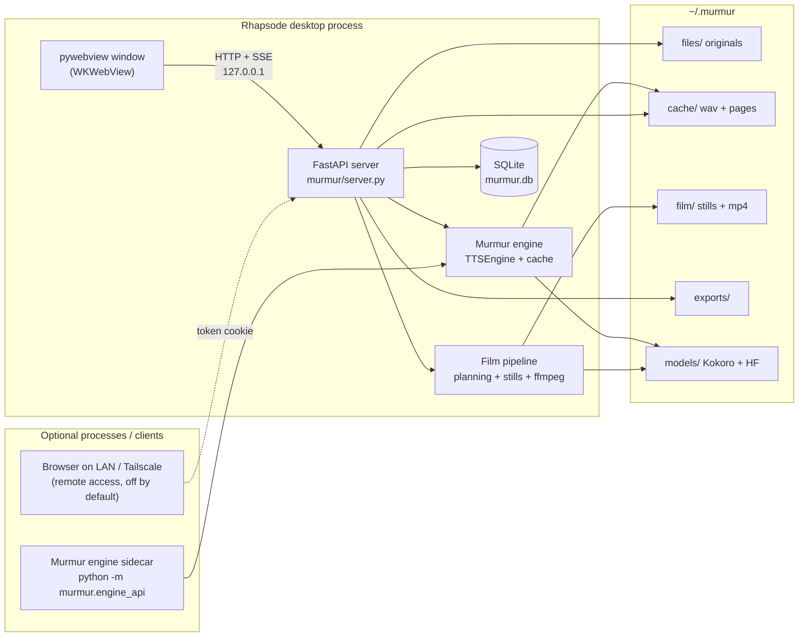
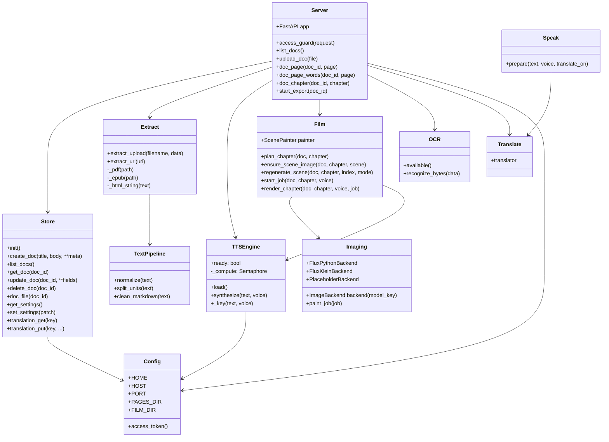
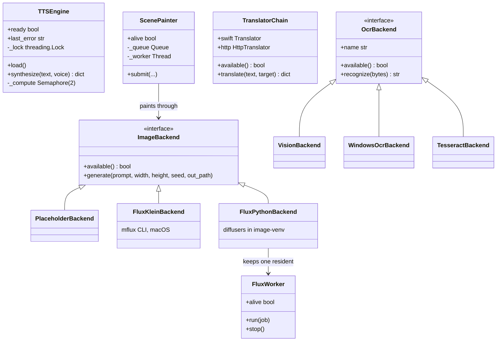
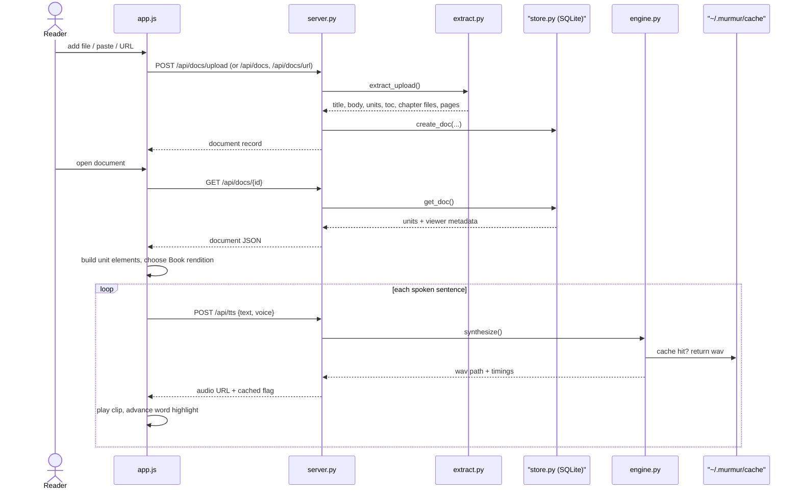
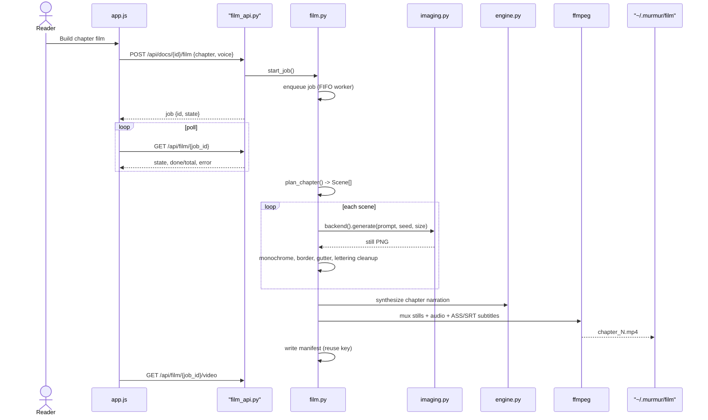
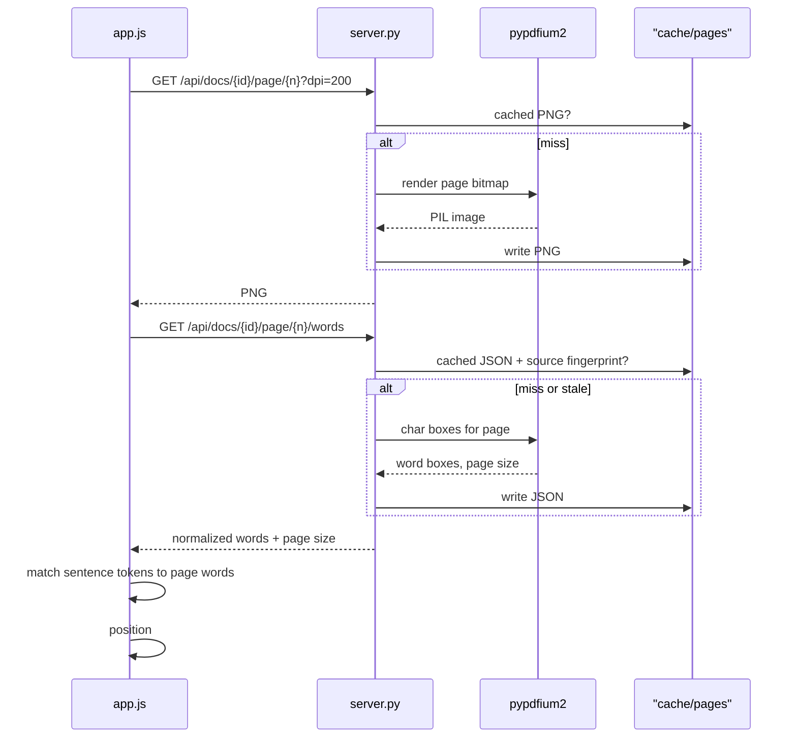
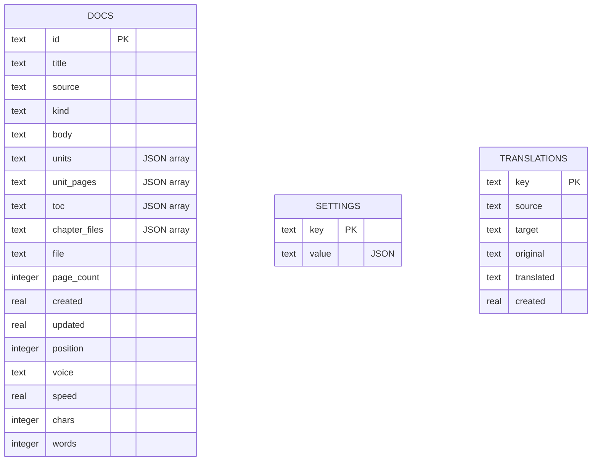
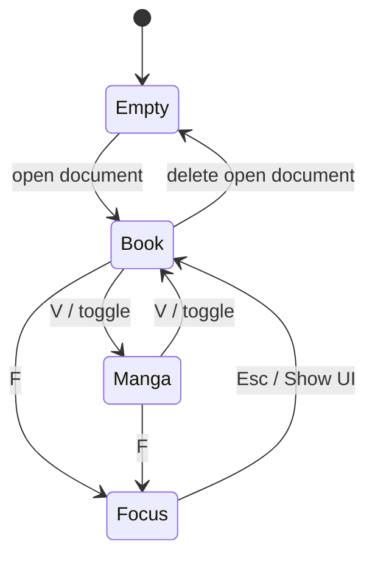
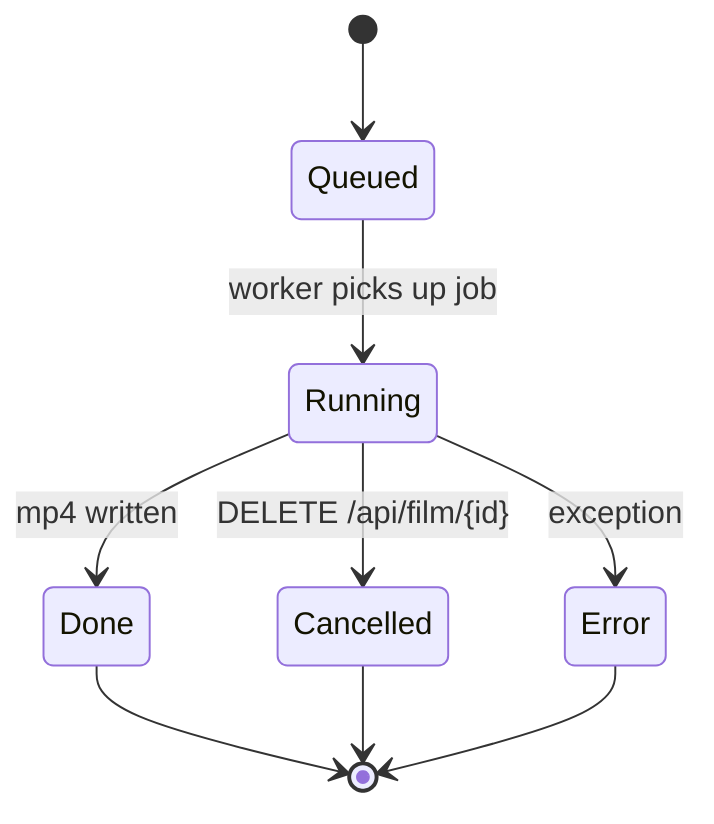
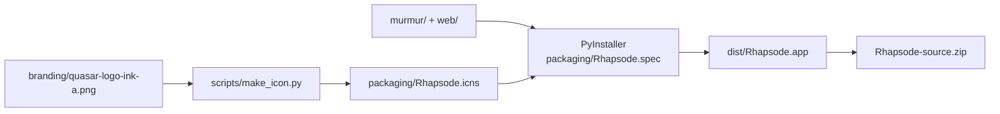

# Rhapsode architecture

Rhapsode is a local read-aloud and manga-film desktop app. The UI is a small
web app served by an in-process FastAPI server; all speech, OCR, translation
and image generation run on the machine. There is no cloud dependency and no
telemetry.

- **Rhapsode** — the desktop app and reader UI.
- **Murmur** — the speech / film engine (also available as a sidecar service).

This document describes the code as it ships today: one FastAPI process, a
web UI inside a native window, and everything else on the local machine. It is
written to be read top-to-bottom once, then used as a map — section 2 is the
file inventory, section 13 is "where do I change this". Platform support and
packaging are in [PLATFORMS.md](PLATFORMS.md), search in [SEARCH.md](SEARCH.md),
stills in [STILLS.md](STILLS.md).

---

## 1. System context



The desktop window and the server share one process. `python -m
murmur.engine_api` starts only the film router plus health and version, for a
frontend that is not the bundled window; the desktop app itself mounts that same
router in-process (`server.py` includes `film_api.router`,
`search_api.router` and `system_api.router`).

---

## 2. Module map (UML class diagram)



### 2.1 Every file, and what it is for

Grouped by job, not by import order. Sizes are rough line counts at 0.2.0-alpha.

**Entry points**

| File | Runs when |
| --- | --- |
| `murmur/desktop.py` | the packaged app: picks a port, starts uvicorn in a thread, opens the pywebview window; `--selftest` starts, checks `/api/health`, exits |
| `murmur/__main__.py` | `python -m murmur`: the same server, browser UI, no native window |
| `murmur/engine_api.py` | `python -m murmur.engine_api`: film + health only, for a separate frontend |
| `murmur/bootstrap.py` | downloads the Kokoro weights (`python -m murmur.bootstrap`) |
| `murmur/fluxgen.py` | the stills child process (`--gguf`, `--serve`, `--once`); never imported by the server |

**Server and API** - `server.py` (253) is the app: static mounts, the access
guard, audio export and the startup hook. `library_api.py` (510) owns every
`/api/docs` route, the PDF lock and the themed chapter viewer; `system_api.py`
holds health, the engine profile, settings, speech and the event bus; `access.py`
is the one place that reads `PUBLIC`/`TOKEN`; `film_api.py` and `search_api.py`
are the other two routers. `runtime.py`
resolves the bind host; `netinfo.py` builds the LAN/Tailscale URLs; `proc.py`
hides child console windows and adopts children into a kill-on-close job.

**Library** — `extract.py` turns a file or URL into `(title, body, units, toc, pages)`;
`text.py` normalises text, splits speech units and aligns words; `store.py` owns
`murmur.db`; `cache.py` is the small LRU used by clips, translations and the
search metadata.

**Speech** — `engine.py` is Kokoro inference plus the wav/meta cache; `voices.py`
is the voice table; `language.py` says which language a sentence is in (script
ranges plus a function-word profile, no model); `speak.py` decides whether a
sentence must be translated first, and only translates when `language.py` says
the text is *not* already the voice's language; `translate.py` chains the macOS
helper and the OpenAI-compatible HTTP endpoint; `backends/tts.py` picks the ONNX
execution provider.

**Stills and films** — `film.py` (1.7k) plans scenes, composes prompts, paints and
renders; `imaging.py` owns the backends and the resident painter; `fluxgen.py`
loads FLUX.2 and paints; `polish.py` redoes hands; `detectors.py` wraps the YOLO
face/person/pose models; `fonts.py` lists installed families for captions.

**Search** — `search.py` (1.2k) is the index and the query path; `semantic.py`
downloads and runs the optional MiniLM embedding model.

**Platform seams** — `config.py` (paths, ports, env), `profile.py` (engine
profiles and the GPU plan), `ocr.py` (Vision → Windows OCR → Tesseract),
`backends/detect.py` (platform/GPU snapshot).

**UI** — `web/index.html` (structure), `web/app.js` (3.6k, behaviour; an ES
module since the Settings split), `web/views/settings.js` (the Settings panel:
appearance, engine, remote access), `web/style.css` (1.8k), `web/themes.js` (20
palettes as data), `web/boot.js` (11 lines, applies the saved theme before first
paint).

`web/app.js` is loaded as `<script type="module">`, and a view is extracted by
moving its functions into `web/views/<name>.js`, exporting one
`create<Name>View(deps)` that receives `$`, `$$`, `api`, `state` and the few
helpers it needs. No bundler: the browser resolves the relative import, the
static import means the module runs before `app.js`'s own body, and the browser
suite (`tests/ui/`) is the safety net for the move.

**Tests** — `tests/`, 163 cases, `unittest`; run from the repo root with
`python -m unittest discover -s tests`.

### 2.2 The types that actually carry behaviour



`TranslatorChain` tries `Translator` (the Swift helper, macOS 26+) and falls back
to `HttpTranslator`; `ocr.backend()` picks the first available backend in the
order above. `FluxWorker` is one child process per machine, guarded by
`flux-painter.lock` — see [STILLS.md](STILLS.md).

---

## 3. Reading pipeline



Notes:

- Speed is applied in the browser, so changing playback speed does not
  re-synthesize audio.
- TTS cache keys include model version, voice, and prepared text. Clips are keyed by
  `sha1(model version + voice + text)`, written atomically to the cache directory,
  and evicted LRU-style at 2 GB (`MURMUR_CACHE_MB`).
- **Sentence units.** Text is split on real sentence boundaries with abbreviation,
  initial and decimal protection. Tiny fragments (headings, `"Yes."`) are merged into
  a neighbour because Kokoro sounds worse on very short inputs, and overly long
  sentences are split at clause punctuation.
- **Timing.** `kokoro-onnx` exposes per-phoneme start/end times. Phonemes are folded
  into word groups (the phonemizer emits a space phoneme between words) and mapped
  onto the original tokens — exact for normal prose, proportionally interpolated for
  numbers and dates that expand into several spoken words.
- `state.wordIdx` drives highlight in all Book renditions: reader spans, EPUB
  iframe spans, and the PDF page overlay.

---

## 4. Chapter film pipeline

The internal names still say *film* — `film.py`, `film_api.py`, `/api/film/*` — but
what the pipeline produces is stills: one generated image per beat, played against
the narration. The MP4 is those stills assembled with dissolves and subtitles. No
motion is synthesized, and no video model is loaded.



Scene review uses `GET /api/film/plan`, `POST /api/film/scene/regenerate`
(`whole` or dragged `region`), and `POST /api/film/prefetch`. Region redraws
crop the selection, redraw with the selected backend, tone-match, and feather
the patch back into the still.

---

## 5. PDF page and word overlay



PDFium is not thread-safe, so both endpoints share `_PDF_LOCK`. Word caches are
keyed by document id and page, and validated against the source file size and
mtime so replacing a PDF cannot serve stale boxes.

---

## 6. Data model



Filesystem layout (macOS shown; see below for Windows/Linux):

```
~/.murmur/
  murmur.db                 library, settings, translations
  access_token              remote-access secret (0600)
  fonts.json                cached font list
  files/<doc_id>.<ext>      original PDF/EPUB/image
  cache/<hash>.wav          TTS clips
  cache/pages/<doc>_<n>*.png|json
  film/<doc_id>/            stills, prompts, cast, chapter mp4
  exports/<job>.mp3|wav     audio exports
  search.db                 derived search index (safe to delete)
  models/                   Kokoro + HF weights (external)
  models/minilm-l6-v2/      optional search embeddings
  image-venv/               optional FLUX runtime
```

Data root by platform (override with `MURMUR_HOME`):

- macOS: `~/.murmur`
- Windows: `%LOCALAPPDATA%\Rhapsode`
- Linux: `$XDG_DATA_HOME/rhapsode` or `~/.local/share/rhapsode`

`search.db` is not part of the library. It holds `books` (per-document
signature and coverage), `chunks` plus its FTS5 index, `vectors` (float32
embeddings), `progress` (reading recency) and `meta`; it is rebuilt from `docs`
whenever it is missing or stale. See [SEARCH.md](SEARCH.md).

---

## 7. Concurrency

| Work | Mechanism | Notes |
| --- | --- | --- |
| HTTP handlers | Uvicorn worker + threadpool | sync handlers run off the event loop |
| TTS synthesis | `TTSEngine._compute` semaphore (2) | model load guarded by a lock |
| PDF render / words | `server._PDF_LOCK` | PDFium is not thread-safe |
| Audio export | `server._EXPORT_LOCK` | one export at a time |
| Search index | one daemon worker in `murmur/search.py` | writes in batches of 200; readers use WAL |
| Search model | background download thread in `murmur/semantic.py` | streams to `*.part`, styled by `status()` |
| Chapter film | FIFO worker in `film.py` | one film job at a time |
| Resident painter | `FluxWorker` child process + `flux-painter.lock` | one painter per machine; restarted from Settings |
| Live events | SSE `/api/events` | quick-read notifications |
| Cache pruning | startup thread | audio LRU + 7-day export cleanup |

---

## 8. API surface

| Method | Path | Purpose |
| --- | --- | --- |
| GET | `/api/health` | server, model, OCR, translation, platform/GPU, painter precision |
| GET | `/api/engine` | active profile, VRAM, painter state |
| POST | `/api/engine/profile` | switch profile (`lite`/`balanced`/`max`/`cpu`) |
| POST | `/api/engine/restart` | stop and respawn the resident painter |
| POST | `/api/cache/prune` | evict audio cache now |
| GET | `/api/network` | connection URLs; token only on loopback |
| GET/PUT | `/api/settings` | persisted preferences |
| GET | `/api/voices` | Kokoro voices by language |
| GET | `/api/fonts` | installed font families |
| POST | `/api/tts` | synthesize one sentence |
| GET | `/api/audio/{name}` | cached wav (range requests) |
| GET/POST | `/api/docs` | list / create text documents |
| POST | `/api/docs/upload` | upload PDF, EPUB, image, Office, HTML |
| POST | `/api/docs/url` | import a web page |
| PATCH/DELETE | `/api/docs/{id}` | update position/voice/speed, remove |
| GET | `/api/docs/{id}/page/{n}` | rendered PDF page |
| GET | `/api/docs/{id}/page/{n}/words` | normalized word boxes |
| GET | `/api/docs/{id}/image` | single-image document |
| GET | `/api/docs/{id}/epub/{asset}` | EPUB internal asset |
| GET | `/api/docs/{id}/chapter/{n}` | themed EPUB chapter HTML |
| POST | `/api/docs/{id}/export` | audio export job |
| GET/DELETE | `/api/export/{job}` | export status / cancel |
| POST | `/api/quick-read` | open a document from a shortcut |
| POST | `/api/ocr-clipboard` | OCR the clipboard |
| GET | `/api/search` | ranked library search (lexical + optional meaning) |
| GET | `/api/search/status` | index coverage, progress, model state |
| POST | `/api/search/index` | start an index pass (optionally forced or one doc) |
| POST | `/api/search/model` | download the optional embedding model |
| GET | `/api/events` | SSE stream |
| GET | `/api/film/plan`, `/images`, `/progress`, `/activity` | scene planning, status and the live engine phase |
| POST | `/api/film/scene`, `/scene/regenerate`, `/prefetch` | scene generation |
| POST | `/api/docs/{id}/film` | start chapter film |
| GET/DELETE | `/api/film/{job}` | film status / cancel |
| GET | `/api/film/{job}/video` | finished mp4 |

---

## 9. Security model

- **Loopback by default.** `remoteAccess` defaults to `false`; the server binds
  `127.0.0.1`. `--host` / `MURMUR_HOST` are explicit overrides.
- **Host header check.** Loopback requests with a non-local `Host` are rejected
  to stop DNS-rebinding attacks.
- **Token for remote clients.** When bound publicly, other devices must open a
  URL containing `?token=…`; the token is stored in an HttpOnly, SameSite=Lax
  cookie. `/api/network` is loopback-only and `no-store`.
- **No CORS.** Cross-origin reads are not enabled; state-changing endpoints take
  JSON, and cookies are `SameSite=Lax`.
- **CSP and headers.** The app ships a strict self-only CSP, `nosniff`,
  `Referrer-Policy: no-referrer`, and `X-Frame-Options`.
- **EPUB sanitizing.** Scripts, frames, forms, base/meta tags, inline handlers,
  remote images, external stylesheets and `@import`/remote `url()` are removed
  before chapter HTML is framed.
- **URL import SSRF guard.** Only `http`/`https`, public IPs only, redirects
  re-validated, download capped at 12 MB.
- **Search is local.** The index is a local SQLite file and never leaves the
  machine. The only outbound request the feature makes is the optional
  embedding-model download, to a fixed `huggingface.co` URL, triggered by an
  explicit `POST /api/search/model` from the user; nothing else is fetched, and
  search itself works with no network at all.
- **Uploads** are capped at 120 MB before and during read.

---

## 10. UI state machines

### Reading view



`Book` resolves per file: PDF/image → page renderer, EPUB → chapter iframe,
text/Markdown → reader. The saved preference is `murmur.view2`; old
`murmur.view` values are ignored so Book is the default after upgrading.

### Chapter film job



---

## 11. Build and packaging



`build_app.sh` runs tests, regenerates the icon, bundles the web assets and
Python modules with PyInstaller, and writes `dist/Rhapsode.app`;
`scripts/make_dmg.sh` wraps that in the drag-install DMG. Windows uses
`scripts\build_installer.ps1` (PyInstaller one-folder, then Inno Setup:
`packaging\Rhapsode-setup.iss`). CI builds all three: `.github/workflows/windows.yml`
runs the suite and builds the installer, `installer.yml` and `macos.yml` attach
their artifacts to a `v*` release, and `linux.yml` starts a real server on a
clean runner. No Linux package exists yet.

---

## 12. Extension points

- **Image backends** implement `ImageBackend.generate(...)`; `FilmImages.backend()`
  selects FLUX.2 (mflux on macOS, `FluxPythonBackend` elsewhere), or the placeholder.
  Add a backend in `imaging.py` and expose it through `film_model()`.
- **OCR** is isolated in `ocr.py`; a new backend implements `available()` and
  `recognize()` and joins the order in `backend()`.
- **Search** is two layers that can be separated: `search.py` (chunks, FTS5,
  fusion, recency) and `semantic.py` (the optional MiniLM model). A new ranker
  belongs in `search.py`; a new embedding model in `semantic.py`.
- **Translation** lives in `translate.py`; the UI treats it as an optional
  capability reported by `/api/health`.
- **Themes** are data, not CSS: `web/themes.js` holds 20 palettes and
  `applyRhapsodeTheme()` sets the CSS custom properties. Chapter HTML receives
  the active ink/accent/highlight colors so the iframe matches.
- **Fonts** come from `/api/fonts` (`murmur/fonts.py`), cached per machine.

---

## 13. Reading the code

### The two request shapes

Almost every endpoint is one of two shapes, and knowing which tells you where
the work lives.

**Synchronous read/write** — parse the body, call one module, return JSON:

```
app.js  fetch("/api/...")
  → server.py handler
    → store.py / text.py / engine.py / search.py
  ← JSON (or a file response)
```

**Job** — the handler registers a dict, hands work to a queue, answers
immediately, and the UI polls a status endpoint (`film`, `export`,
`search/index`):

```
POST /api/docs/{id}/film → film.start_job() → 202 {id, state}
GET  /api/film/{id}      → film.JOBS[id]     (poll)
GET  /api/film/{id}/video→ FileResponse(mp4)
```

Nothing in the UI holds a websocket; `/api/events` is SSE and only carries
quick-read notifications.

### Where to change what

| Want to… | Touch |
| --- | --- |
| add an HTTP endpoint | the matching router (`library_api.py` for documents, `system_api.py` for health/settings/speech, `film_api.py`, `search_api.py`) or `server.py` for exports and static, then `web/app.js` |
| add a voice | `voices.py` (`VOICES`, `DEFAULT_VOICE`); the UI reads `/api/voices` |
| change the Settings panel | `web/views/settings.js` (it receives its dependencies; add one to `createSettingsView` rather than reaching into `app.js`) |
| change how sentences are split | `text.py:split_units` — everything downstream is measured in units |
| change speech quality or caching | `engine.py` (`_key`, `synthesize`), `cache.py` |
| add an OCR engine | `ocr.py`: implement `OcrBackend`, add to `backend()` |
| add an image backend | `imaging.py`: implement `ImageBackend`, expose in `FilmImages.backend()` |
| change what a still looks like | `film.py:plan_chapter` / `compose_prompt`, `config.FILM_STYLE` |
| change search ranking | `search.py:search` (RRF, recency, gates) |
| touch the schema | `store.py:init` (docs) or `search.py:_db` (search index) — both migrate in place |
| change a theme | `web/themes.js` (data only: id, mode, colors) |
| change window/port behaviour | `desktop.py`, `runtime.py`, `config.py` |

### Invariants worth not breaking

- **A unit is the unit.** Speech, highlighting, film scenes and search anchors
  all index into `units`. Re-splitting text invalidates saved positions,
  scene plans and cached clips together.
- **Cache keys are content keys.** A clip key is
  `sha1(model version + voice + prepared text)`; the translation cache is keyed
  the same way. Anything that changes the spoken text must change the key.
- **`search.db` is derived.** It is safe to delete and is rebuilt from `docs`;
  never make it the only home of a fact.
- **One painter per machine.** `flux-painter.lock` holds the child's pid and
  its parent's; two 15 GiB loads cannot share a card.
- **Loopback by default.** Public binding is a runtime decision
  (`runtime.resolve_host`), not a config constant.

### Known shape issues

Not bugs; the places where reading the code costs more than it should, and the
natural targets for a refactor:

| Area | Size | Why it is hard |
| --- | --- | --- |
| `web/app.js` | 3.7k lines | one file: state, API wrappers, library, reader, player, search, cinema, settings, scene editor. No JS tests. |
| `murmur/server.py` | 253 lines | app setup, access guard, audio export, static mounts; the routes live in `library_api.py`, `system_api.py`, `film_api.py` and `search_api.py`. |
| `murmur/library_api.py` | 510 lines | every `/api/docs` route: ingest, upload, PDF page render and word boxes, EPUB chapters, patch and delete. |
| `murmur/film.py` | 1.7k lines | planning, prompt writing, painting, polish, and ffmpeg rendering share one module and one queue. |
| `tests/` | 217 cases | Python only, except six browser journeys in `tests/ui/` that need playwright and skip without it. |

---

## 14. Decisions, and the roads not taken

Every architecture is a set of bets. These are the ones this code makes, what was
rejected instead, and what each choice costs — written down with the costs, so
the section can be argued with.

### 14.1 A loopback HTTP server, not a desktop framework

**Chosen:** one Python process serving a FastAPI app on `127.0.0.1`, with the UI
as plain ES modules fetched from the same origin; `pywebview` optionally wraps
that origin in a native window.

**Rejected:** Electron or Tauri. Both bring a second language and toolchain into
a project whose real difficulty is Python packaging and GPU drivers, and both
bundle a browser the machine already has.

**Why it holds:** the browser is the most-tested renderer available, the same
code serves plain `localhost` mode for headless use, and SSE covers the one place
the UI needs a push (`/api/events`, for quick-read). CSP, the access guard and
`local_host_ok()` (DNS-rebinding defence) keep a local server from becoming a
remote one.

**What it costs:** no native menus, tray or file associations beyond what
`desktop.py` does by hand; nine UI views sharing one 3.7k-line script; and the
app is a web app in a costume, which shows wherever browsers differ.

### 14.2 SQLite and FTS5, not a vector database

**Chosen:** `murmur.db` for the library and `search.db` for the index, both
SQLite; keyword search over an FTS5 table, meaning search over vectors from an
optional 23 MB ONNX model, the two fused with reciprocal rank fusion.

**Rejected:** a vector store (Chroma, LanceDB, Qdrant). Each is a dependency with
its own release cadence, one more thing to install on three platforms, and — for
a library measured in thousands of chunks — a slower answer than a scan.

**Why it holds:** FTS5 ships inside CPython's `sqlite3`, so keyword search needs
nothing installed; fusion is `sum(1 / (60 + rank))` over two lists, about twenty
lines; `sqlite3` gives transactions and crash safety for free.

**What it costs:** no approximate nearest-neighbour index, so the semantic lane is
linear in chunks and would need rethinking at millions of passages; and the index
is a second store that has to be rebuilt when it drifts, which is why it is
*derived* and never migrated by hand.

### 14.3 No telemetry, and nothing leaves the machine

**Chosen:** zero analytics, zero crash reporting, no account. The only network
traffic is what the user asked for: a weight download, an optional translation
endpoint, an optional embedding model, or a document imported from a URL.

**Rejected:** anonymous usage stats and Sentry-style crash reporting. They would
make the product measurably easier to improve, and impossible to describe as
offline.

**Why it holds:** privacy is the pitch, and a pitch you cannot audit is
marketing. `/api/network` reports `enabled: false` and `remoteAccess: false` as a
fact the user can check, and the security model in section 9 is short because the
surface is.

**What it costs:** a bug report is whatever the reporter types — there is no stack
trace unless they paste one. That is the honest argument for a **Copy
diagnostics** affordance (version, platform, the health JSON, the last log
lines) in the app, and for `docs/TROUBLESHOOTING.md` being written for someone
debugging their own machine.

### 14.4 Weights are downloaded, never bundled

**Chosen:** the app ships as code; Kokoro (~340 MB), the FLUX transformer and the
detectors are fetched on first use into the data directory.

**Rejected:** bundling the models. It would turn a 138 MB installer into several
gigabytes and put third-party weights inside an MIT repository.

**Why it holds:** the installer stays small enough to download on a bad
connection, the licences stay separable (`THIRD_PARTY.md` audits every weight),
and a model can be replaced without rebuilding the app.

**What it costs:** first run needs the network and a progress UI that has to be
honest about size; a failed download is a support burden of its own; and an
air-gapped machine needs the documented manual path.

### 14.5 The painter is a child process with a lock and a budget

**Chosen:** stills are painted by a separate interpreter (`imaging.py` spawns it,
`flux-painter.lock` keeps one at a time), on a measured VRAM budget, with a
quantization ladder and a refusal to start when the card is already full.

**Rejected:** loading the diffusion stack in the server's process. A 10-15 GB
model load there means one bad frame takes the reader down with it, and a
CUDA/ROCm `torch` wheel cannot share an interpreter with a stable `onnxruntime`
build.

**Why it holds:** a crash costs one still rather than the session; the engine can
live in its own virtualenv with the vendor's torch; and the lock makes "one
painter per machine" a fact instead of a hope. The numbers behind the budget are
in [STILLS.md](STILLS.md).

**What it costs:** an IPC boundary (JSON over files and pipes), a startup cost on
the first still of a session, stale-pid handling in the lock, and progress that
has to be reported deliberately — which is what `murmur/activity.py` is for.

### 14.6 Jobs are polled, not pushed

**Chosen:** film renders, exports and indexing register a job, answer `202`, and
the UI polls a status endpoint; one process-wide activity record says what the
engine is doing.

**Rejected:** websockets and a broker-backed task queue. Both are more moving
parts than a single-user local app can justify.

**Why it holds:** polling survives sleep, a closed lid and a reloaded tab; the
same status object feeds Settings, so the UI and the API cannot disagree about
what is running.

**What it costs:** latency between a state change and the screen, a job registry
that lives in memory and is lost on restart, and no fan-out beyond one worker.

### 14.7 One segmentation, indexed by everything

**Chosen:** `text.py:split_units` decides what a sentence is, once. Speech, the
word highlight, film scenes and search anchors all address `units`.

**Rejected:** per-subsystem splitting. Each would be locally simpler and would
drift, so a highlight would land on a different sentence than the one search
found.

**Why it holds:** every coordinate in the app — a saved reading position, a scene
plan, a cached clip, a search hit — is the same kind of number.

**What it costs:** changing the splitter is a breaking change for stored
positions, plans and clips at once (see the invariants in section 13), so it needs
a migration story rather than a patch.

### 14.8 The changelog lives in the repository

**Chosen:** `CHANGELOG.md` is the running history, rendered into a truncated block
at the bottom of the README by `scripts/changelog_render.py`, with a test that
fails when the copy is stale.

**Rejected:** release notes written at tag time. They get written from memory, by
whoever is least free, and the repository is then left with no history a reader
can walk.

**Why it holds:** every change carries its own sentence, in the commit that made
it; the README shows the newest few without a second copy to maintain.

**What it costs:** the rendered block is a merge-conflict magnet — every parallel
branch touches it, and the only clean resolution is to take the other side and
re-render.
