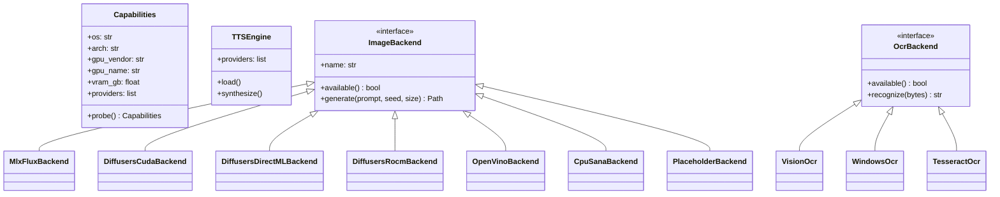

# Rhapsode cross-platform and GPU plan

Goal: ship Rhapsode on macOS, Windows, and Linux, using whatever accelerator is
available (Apple Silicon, NVIDIA, AMD, Intel) and falling back to CPU without
breaking the reading experience. Reading (TTS, highlight, PDF/EPUB) must always
work; manga films degrade in quality/speed, not availability.

This is a plan plus the architecture it requires.

### Implemented in the portability pass

- Platform data directories: macOS keeps `~/.murmur`; Windows uses
  `%LOCALAPPDATA%\Rhapsode`; Linux uses `$XDG_DATA_HOME/rhapsode`.
- OCR backend facade: Apple Vision on macOS, Tesseract on Windows/Linux.
- TTS provider selection through `MURMUR_TTS_PROVIDER` / `ONNX_PROVIDER`.
- Device-agnostic Sana backend (MPS, CUDA, CPU with explicit opt-in).
- Capability probe exposed through `/api/health`.
- Pillow-based TIFF/BMP/WebP conversion with a `sips` fallback; HEIC uses
  `pillow-heif` when installed.

Still planned: native Windows/Linux packages, DirectML/ROCm/OpenVINO image
backends, WebView2/GTK desktop builds, and installers.

---

## 1. Target matrix

| Tier | Platform | Window | TTS | OCR | Films (High) | Films (Fast) | Package |
| --- | --- | --- | --- | --- | --- | --- | --- |
| A (current) | macOS 13+, Apple Silicon | WKWebView | Kokoro ONNX (CPU/CoreML) | Vision | FLUX.2 klein via MLX | Sana 1024 (MPS) | `.app` + DMG |
| A | macOS Intel | WKWebView | Kokoro ONNX CPU | Vision | CPU Sana only | Sana 512 CPU | `.app` + DMG |
| B | Windows 11, NVIDIA | WebView2 | Kokoro ONNX (CUDA provider) | Windows OCR / Tesseract | FLUX.2 klein via diffusers (≥12 GB VRAM) | Sana 1024 CUDA | MSIX or NSIS |
| B | Windows 11, AMD | WebView2 | Kokoro ONNX (DirectML) | Windows OCR / Tesseract | Sana 1024 DirectML (FLUX CPU only) | Sana 512 DirectML | MSIX or NSIS |
| B | Windows 11, Intel | WebView2 | Kokoro ONNX (DirectML/OpenVINO) | Windows OCR | Sana 1024 DirectML/OpenVINO | Sana 512 | MSIX or NSIS |
| B | Linux, NVIDIA | GTK/WebKitGTK | Kokoro ONNX (CUDA) | Tesseract | FLUX.2 via diffusers CUDA | Sana 1024 CUDA | AppImage + deb |
| C | Linux, AMD | GTK/WebKitGTK | Kokoro ONNX (ROCm) | Tesseract | Sana 1024 ROCm | Sana 512 ROCm | AppImage + deb |
| C | Linux, Intel | GTK/WebKitGTK | Kokoro ONNX (OpenVINO) | Tesseract | Sana 1024 OpenVINO/oneAPI | Sana 512 | AppImage + deb |
| C | Any, no GPU | any | Kokoro ONNX CPU | OS/Tesseract | Sana 512 CPU (slow) | Sana 512 CPU | same |

Definitions:

- **High** = best available still generator at 1080p film output.
- **Fast** = quick preview quality; must finish a chapter in minutes on the
  target machine.
- **CPU-only** must still open, read, highlight, export audio, and show stills;
  film generation may take hours but must not crash.

---

## 2. What is portable today, and what is not

| Component | Current implementation | Portability |
| --- | --- | --- |
| UI | static `web/` + FastAPI | portable |
| Desktop shell | `murmur/desktop.py`, pywebview + WKWebView | pywebview supports WebView2/GTK, needs per-OS code |
| Library/text | `store.py`, `extract.py`, `text.py` | portable |
| TTS | `kokoro-onnx` via `engine.py` | portable; provider selection needed |
| Audio cache | wav files + SQLite metadata | portable |
| PDF | `pypdfium2` | portable (wheels per OS/arch) |
| EPUB | stdlib `zipfile` + BeautifulSoup | portable |
| OCR | Apple Vision (`ocr.py`) | **macOS only**; needs backend interface |
| Image gen | `imaging.py`: mflux FLUX.2 (MLX) + diffusers Sana (MPS) | **Apple-centric**; needs CUDA/DirectML/ROCm backends |
| Video | ffmpeg + libass | portable if bundled |
| Image conversion | macOS `sips` for TIFF/BMP/HEIC | replace with Pillow + `pillow-heif` |
| Icon | `.icns` from `branding/` | needs `.ico` + Linux PNGs |
| Paths | `~/.murmur` | use OS data dirs |
| Packaging | PyInstaller `.spec` + `.app` | one spec per OS |

---

## 3. Backend architecture

Introduce a capability layer so the UI and film pipeline never branch on OS or
vendor directly.



New modules:

```
murmur/backends/
  __init__.py
  detect.py          # GPU/vendor/VRAM probing, cached
  tts.py             # ONNX Runtime provider selection
  images.py          # backend registry + generate()
  ocr.py             # platform OCR adapters
```

### Detection order

1. Explicit settings (`imageBackend`, `ttsProvider`) or env overrides win.
2. Probe hardware:
   - macOS arm64 → `mlx` if importable; else `mps`; else CPU.
   - Windows → `torch.cuda.is_available()` (NVIDIA); else `torch_directml`
     (AMD/Intel); else CPU.
   - Linux → CUDA; else ROCm (`torch.version.hip`); else OpenVINO/IPEX; else CPU.
3. For image generation, require a minimum VRAM for FLUX (≈12 GB); otherwise
   select Sana 1024, then Sana 512, then placeholder/CPU.
4. TTS: prefer GPU providers in order CUDA → CoreML → DirectML → CPU.
5. OCR: native OS OCR → Tesseract → disabled (show a settings note, keep
   text-based PDFs working).

### Reporting

`/api/health` gains:

```json
{
  "accelerator": "cuda",
  "gpu": "NVIDIA RTX 4070",
  "vramGb": 12,
  "ttsProvider": "CUDAExecutionProvider",
  "imageBackend": "diffusers-cuda",
  "filmQuality": { "high": true, "fast": true },
  "ocr": "windows"
}
```

The settings modal shows the active accelerator and disables “High” with an
explanation when FLUX is not viable.

---

## 4. Windows plan

### 4.1 Runtime

- Window: pywebview with Edge WebView2 runtime (bundled or bootstrapped).
- Process model: same as macOS — FastAPI + UI in one process; engine sidecar
  available for advanced users.
- Data dirs:
  - `%LOCALAPPDATA%\Rhapsode\` for db, cache, film, exports.
  - `%USERPROFILE%\.murmur` remains a fallback for migration.
- Replace `sips` with Pillow (`pillow-heif` for HEIC).
- Bundle `ffmpeg.exe` (+ libass) under `resources/bin/`.
- Keyboard: show `Ctrl` instead of `⌘` in hints; app menu and window controls
  handled by pywebview.

### 4.2 NVIDIA

1. Installer ships CPU wheels; optional “GPU pack” downloads CUDA-enabled
   `onnxruntime-gpu` and `torch` wheels matching the driver.
2. `detect.py` runs `nvidia-smi` and `torch.cuda` probe.
3. TTS uses `CUDAExecutionProvider`; falls back to CPU per request.
4. Images:
   - ≥12 GB VRAM: FLUX.2 klein through `diffusers` (or a quantized variant) for
     **High**.
   - 6–12 GB: Sana 1024 CUDA for **Fast**; High disabled.
   - <6 GB: Sana 512.
5. Model weights download on first film build into `%LOCALAPPDATA%\Rhapsode\models\hf`.

### 4.3 AMD

1. Windows has no official ROCm PyTorch; use **DirectML**:
   `torch-directml` (`torch_directml.device()`), and `onnxruntime-directml`.
2. TTS via DirectML provider; if unavailable, CPU (Kokoro is fast enough).
3. Images: Sana 1024/512 through diffusers on the DirectML device. FLUX is not
   practical without CUDA; “High” falls back to Sana with a note.
4. Detect with `torch_directml.device_count()` and WMI (`Win32_VideoController`)
   for the adapter name/VRAM.
5. Known limits: some ops fall back to CPU; first-run shader compilation is
   slow; memory fragmentation can require smaller tiles.

### 4.4 Intel

1. Prefer **OpenVINO** for TTS/OCR where available, otherwise DirectML, else
   CPU.
2. Images: Sana 512/1024 on DirectML or OpenVINO; Arc discrete GPUs can use
   ≥8 GB; integrated GPUs default to Sana 512 or CPU.
3. Same UI capability reporting as AMD.

### 4.5 Windows packaging

- Prefer **MSIX** for signed distribution, **NSIS** for a portable installer.
- WebView2: Evergreen runtime check at startup with a clear install link.
- Code signing certificate required to avoid SmartScreen warnings.
- Icon: generate `.ico` (16–256 px) from the same branding source.

---

## 5. Linux plan

### 5.1 Runtime

- Window: pywebview with GTK + WebKitGTK (install `gir1.2-webkit2-4.1`), or
  fall back to opening the system browser at `127.0.0.1`.
- Package: AppImage (self-contained) plus `.deb`.
- Data dir: `$XDG_DATA_HOME/rhapsode` (default `~/.local/share/rhapsode`).
- OCR: Tesseract (`tesseract-ocr` + language packs) or PaddleOCR; bundle
  Tesseract for AppImage.
- Font discovery: `fc-list : family` (already implemented in `fonts.py`).
- ffmpeg: bundle static build with libass.

### 5.2 NVIDIA

- CUDA PyTorch wheels; `onnxruntime-gpu`; same selection as Windows NVIDIA.
- High: FLUX.2 via diffusers if VRAM allows; Fast: Sana.

### 5.3 AMD

- ROCm PyTorch (`torch.version.hip`) on supported GPUs/drivers; otherwise CPU.
- `onnxruntime-rocm` if available; else CPU TTS.
- Sana via ROCm; FLUX only on ≥16 GB and supported architectures.
- Detection must distinguish “ROCm installed but device unsupported” and fall
  back cleanly.

### 5.4 Intel

- Intel Extension for PyTorch (IPEX) or OpenVINO; oneAPI runtime.
- Sana 512/1024 via IPEX; TTS via OpenVINO.
- Integrated GPUs: Fast/CPU only.

### 5.5 Linux packaging

- AppImage with bundled Python, ffmpeg, Tesseract data, and web assets.
- `libwebkit2gtk` is a system dependency for the window; if missing, open the
  browser instead of failing.
- `.desktop` file and PNG icons (16–512 px) from the branding source.

---

## 6. Dependency and model distribution

Do **not** bundle all GPU stacks in one installer (multiple GB, driver
conflicts). Use a base install + optional accelerator packs.

Pin **Python 3.11 or 3.12** for the Windows/Linux GPU builds until
`torch-directml`, ROCm wheels, and OpenVINO support the same Python version as
the macOS build (3.13 at the time of writing). The macOS bundle can stay on the
newer interpreter.

```
Base (all platforms)
  Python runtime, FastAPI, pypdfium2, Pillow, ffmpeg, web UI
  kokoro-onnx + voices + Kokoro model    (CPU works everywhere)
  Tesseract or native OCR bridge
  Sana 512 CPU-capable diffusers stack?  (optional; large)

Accelerator packs
  macos-arm64: mlx + mflux + FLUX.2 weights
  windows-nvidia: torch+cu###, onnxruntime-gpu
  windows-amd: torch-directml, onnxruntime-directml
  windows-intel: openvino, onnxruntime-openvino
  linux-nvidia: torch+cu###, onnxruntime-gpu
  linux-amd: torch-rocm, onnxruntime-rocm
  linux-intel: intel-extension-for-pytorch / openvino

Weights (downloaded on demand, never in the installer)
  ~/.murmur/models/kokoro/*, models/hf/*
  %LOCALAPPDATA%\Rhapsode\models\...
```

Installer flow:

1. Install base app.
2. Detect hardware.
3. Offer “Enable GPU acceleration” with a one-click pack download.
4. First film build downloads only the selected model.

This keeps the base app small and makes CPU-only installs viable.

---

## 7. CI and release matrix

| Job | Runner | Output |
| --- | --- | --- |
| macOS arm64 | `macos-14` | `Rhapsode-<ver>-arm64.dmg` |
| Windows x64 | `windows-2022` | `Rhapsode-<ver>-x64.msix` / `.exe` |
| Linux x64 | `ubuntu-22.04` | `Rhapsode-<ver>-x86_64.AppImage`, `.deb` |
| Engine sidecar | all three | `rhapsode-engine-<os>-<arch>` |
| Source | `ubuntu-latest` | `Rhapsode-source.zip` + sha256 |

Each job runs:

1. `python -m unittest discover -s tests`
2. `node --check web/*.js`
3. platform PyInstaller spec
4. smoke test: launch with `--selftest`, hit `/api/health`, open a sample doc
5. sign/notarize (macOS), sign (Windows), package.

`packaging/` becomes:

```
packaging/
  Rhapsode.spec            # macOS (current)
  Rhapsode-windows.spec
  Rhapsode-linux.spec
  entry.py
  icons/  Rhapsode.icns, Rhapsode.ico, rhapsode-*.png
```

---

## 8. Code changes required

Ordered by dependency:

1. **Config paths** — `config.HOME` picks OS data dirs; migrate `~/.murmur`.
2. **OCR interface** — `murmur/backends/ocr.py` with Vision/Windows/Tesseract.
3. **TTS providers** — select ONNX providers; expose status.
4. **Image backend registry** — refactor `imaging.py` into backends + detection;
   keep `mflux` path for macOS.
5. **Window shell** — platform branches in `desktop.py`; Linux fallback to
   browser; Windows WebView2 check.
6. **Image conversion** — replace `sips` with Pillow (+HEIF).
7. **Packaging** — OS specs, icons, ffmpeg/Tesseract bundling, installers.
8. **Settings/UI** — accelerator panel, disabled High state, font list (done),
   theme grid (done).
9. **Telemetry-free update check** — optional, off by default.

---

## 9. Risks and mitigations

| Risk | Mitigation |
| --- | --- |
| GPU wheels are huge and brittle | base install + optional packs; pin driver-compatible versions |
| AMD Windows has no CUDA/ROCm | DirectML path; keep Fast quality; clearly label High as unavailable |
| Intel integrated GPUs are slow | default to Sana 512/CPU; disable film queue parallelism |
| ROCm support varies by distro/GPU | detect and fall back to CPU; document supported cards |
| WebView2/WebKitGTK missing | bootstrap/install prompt; browser fallback |
| Code signing cost/complexity | plan certificates early; unsigned builds for dev |
| Model licenses differ | verify FLUX/Sana/Kokoro licenses per distribution; keep weights out of installers |
| Path differences break caches | centralize in `config`, migration on first run |

---

## 10. Suggested milestones

1. **M1 — portability seams (no new OS builds):** config paths, OCR/TTS/image
   backend interfaces, replace `sips`, fonts, theme/font UI. macOS behavior
   unchanged.
2. **M2 — Windows NVIDIA:** WebView2 shell, PyInstaller spec, CUDA packs, OCR,
   installer. Goal: feature parity for reading and films on a 12 GB NVIDIA card.
3. **M3 — Linux NVIDIA:** AppImage, ROCm/CUDA detection, Tesseract, browser
   fallback. Goal: reading + Fast films.
4. **M4 — Windows/Linux AMD + Intel:** DirectML/OpenVINO paths, capability UI,
   documented quality tiers.
5. **M5 — release engineering:** signing, notarization, CI matrix, update flow,
   crash reporting (local logs only).
